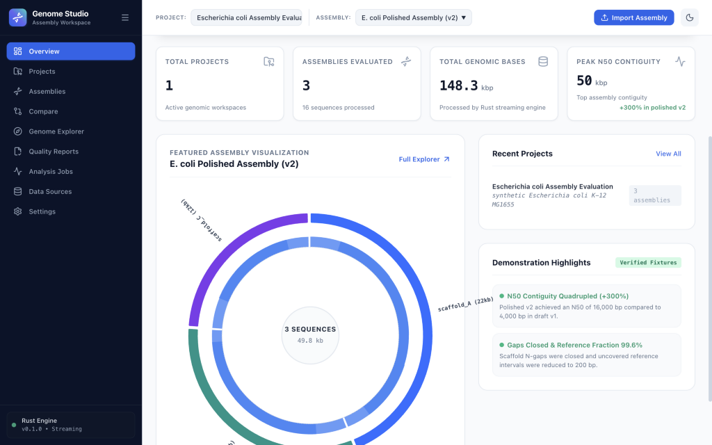
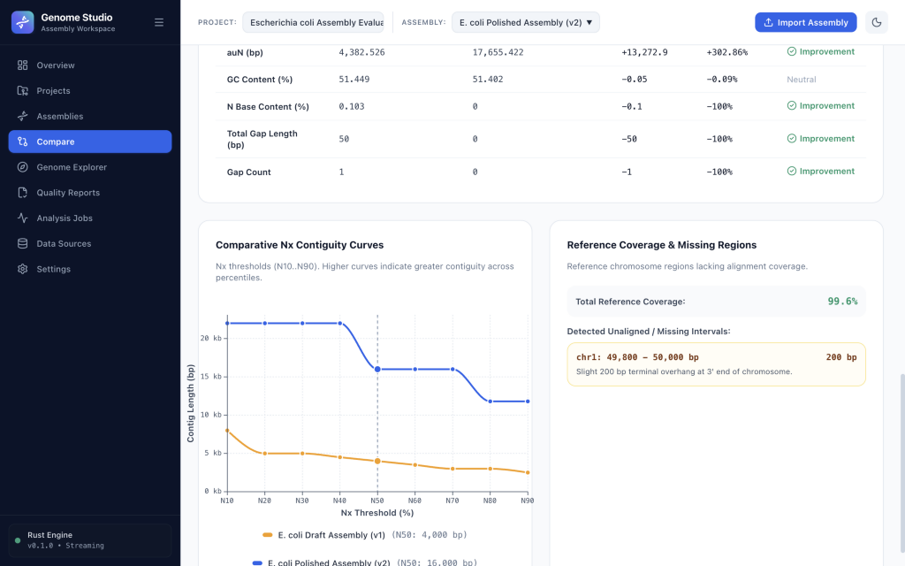
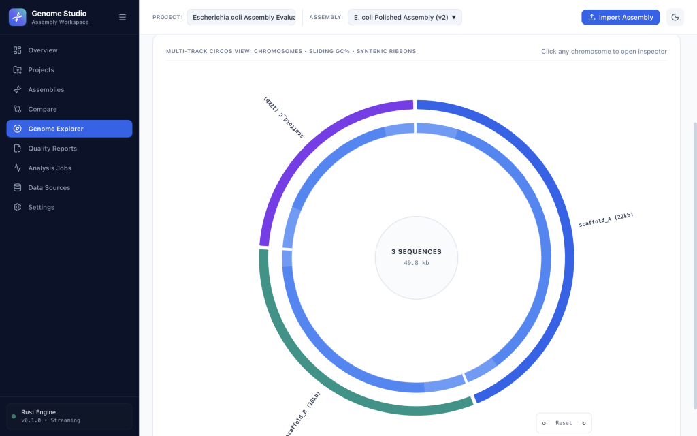
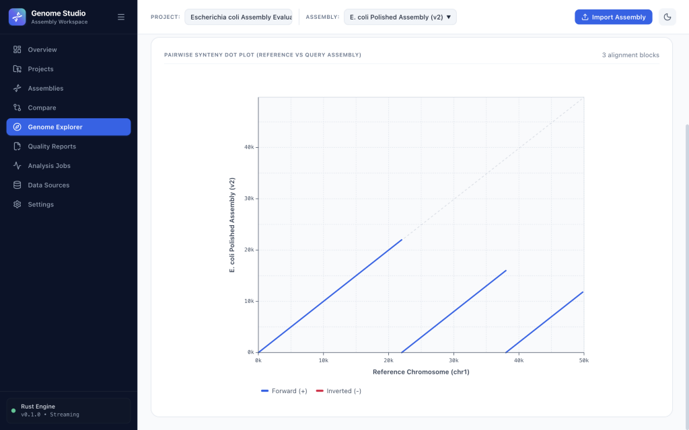
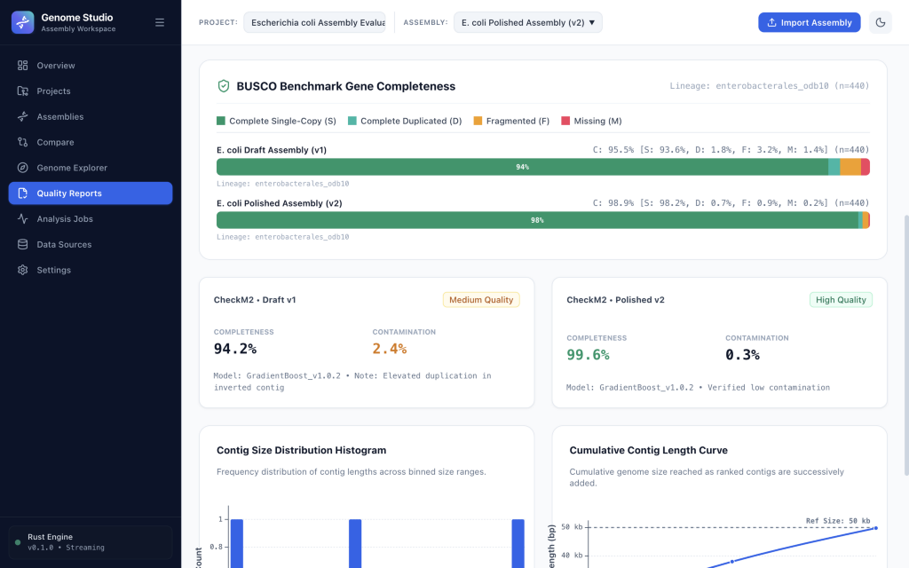
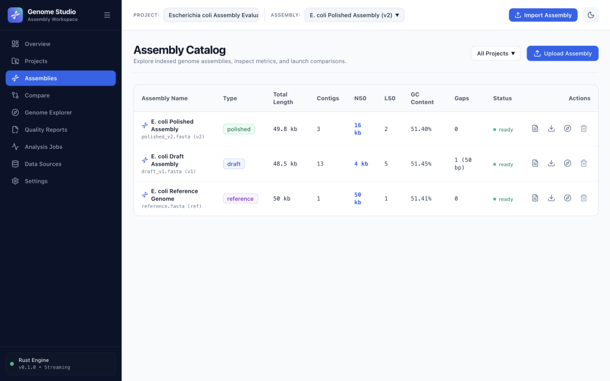
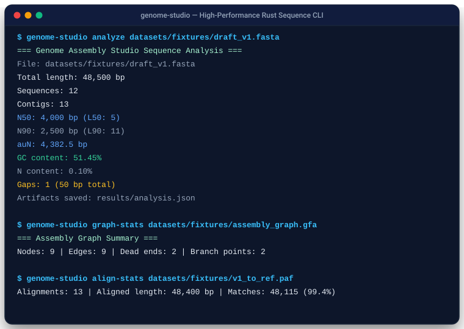

# Genome Assembly Studio

<div align="center">

**Explore, evaluate, and compare genome assemblies.**

[](./LICENSE)
[](https://www.rust-lang.org)
[](https://fastapi.tiangolo.com)
[](https://nextjs.org)
[](https://react.dev)
[](https://www.typescriptlang.org)
[](./CONTRIBUTING.md)

_A high-performance visual workspace and analytical platform for exploring genome assemblies, assessing contiguity and biological completeness, investigating structural anomalies, and comparing assembly iterations._

<br />

[](docs/screenshots/overview.png)

</div>

---

## Overview

Modern genome assembly projects generate iterative candidate genomes across varying sequencing technologies (Illumina short reads, Oxford Nanopore duplex, PacBio HiFi) and assemblers (Flye, Hifiasm, Canu, SPAdes). Researchers often struggle to evaluate whether an assembly version is genuinely improved or simply longer due to unpurged haplotype duplications and chimeric joins.

**Genome Assembly Studio** bridges low-level sequence processing and high-end interactive scientific visualization:

- Combines the analytical contiguity depth of **QUAST**.
- Incorporates the lineage completeness assessments of **BUSCO**.
- Integrates the microbial quality scoring of **CheckM2**.
- Delivers the assembly graph exploration capabilities of **Bandage**.
- Provides whole-chromosome circular visualization inspired by **Circos**.
- Implements multi-scale genomic navigation with nucleotide-level zoom.

---

## Visual Showcase

### Executive Assembly Dashboard

Unified view with real-time contiguity metrics ($N_{50}$, $L_{50}$, auN), total genomic span, active projects, and live interactive Circos Genome Wheel preview.

[](docs/screenshots/overview.png)

### Assembly Comparison Studio

Automated Scientific Findings engine deriving actionable conclusions (improvements, regressions, and trade-offs), 9-metric delta matrix, comparative Nx curves ($N_{10}$–$N_{90}$), and missing alignment coverage intervals.

[](docs/screenshots/comparison.png)

### Circular Genome Wheel & Multitrack Navigation

Interactive Circos-style chromosome visualization with rotation controls, cytoband rendering, sliding-window GC profile heatmaps, and syntenic Bezier connection ribbons.

[](docs/screenshots/explorer-wheel.png)

### Pairwise Synteny Dot Plot

Interactive 2D whole-genome alignment dot plot with cumulative chromosome coordinates, collinear forward blocks (blue), inversions/translocations (rose), and scaffold boundary guidelines.

[](docs/screenshots/explorer-dotplot.png)

### Quality & Biological Completeness

Multi-tool benchmarking integrating lineage-specific BUSCO single-copy/duplicated/fragmented ortholog stacks and CheckM2 gradient-boosted completeness and contamination assessments.

[](docs/screenshots/quality-reports.png)

### Assembly Catalog & Management

Complete sequence inventory with instant Rust streaming stats, gap tracking, format detection, direct download of Markdown evaluation reports, and BED gap track exports.

[](docs/screenshots/assemblies.png)

### High-Performance Rust Sequence CLI (`genome-studio`)

Streaming buffered FASTA, GFA 1.0, and PAF parsers computing exact contiguity metrics, base distributions, and graph topology in sub-millisecond execution time.

<div align="center">



</div>

---

## Key Capabilities

- **Blazing Fast Rust Sequence Core (`genome-studio`)**: Streaming buffered FASTA, GFA 1.0, and PAF parsers computing exact contiguity metrics ($N_{10}$..$N_{90}$, L50, auN), base distributions, gaps, and binary indexing in sub-millisecond retrieval time.
- **Automated Comparison & Decision Engine**: Evaluates assembly pairs or series, computing directional deltas and surfacing concrete scientific findings (improvements, regressions, and trade-offs).
- **Interactive Circos Genome Wheel**: Multi-track circular chromosome layouts featuring cytoband tracks, sliding-window GC percentage heatmaps, GC skew line tracks, and central synteny Bezier ribbons.
- **Synteny Dot Plot & Alignment Inspection**: Interactive 2D coordinate alignment plots distinguishing forward collinear blocks (blue) from inversions and translocations (rose).
- **Bandage-Style GFA Assembly Graph Viewer**: Force-directed topological graph visualization highlighting dead ends, bubble structures, and connected components.
- **Multi-Scale Linear Genome Browser**: Pan-and-zoom chromosome navigator with an overview minimap, sliding-window GC profile, scaffold gap annotations, and monospaced nucleotide sequence rendering when zoomed to $< 120$ bp.
- **Rich Scientific Application Shell**: Dark/Light mode support, project switcher, contextual inspector drawer, and 9 primary workspaces.

---

## Workspaces & Modules

| Workspace             | Route         | Key Features                                                                              |
| --------------------- | ------------- | ----------------------------------------------------------------------------------------- |
| **Overview**          | `/`           | Executive assembly dashboard, recent projects, key metric cards, tool status.             |
| **Projects**          | `/projects`   | Multi-assembly project manager, reference genome assignment, organism metadata.           |
| **Assemblies**        | `/assemblies` | Drag-and-drop FASTA upload, instant Rust analysis, sequence lists, and gap topologies.    |
| **Comparison Studio** | `/compare`    | Side-by-side metric matrix, Automated Findings engine, dual Nx curve overlays.            |
| **Genome Explorer**   | `/explorer`   | 4 viewing modes: Circos Genome Wheel, Synteny Dot Plot, GFA Graph Viewer, Linear Browser. |
| **Quality Reports**   | `/quality`    | BUSCO stacked ortholog charts, CheckM2 completeness/contamination, contig histograms.     |
| **Analysis Pipeline** | `/jobs`       | Background job execution engine, multi-stage progress tracking, live console logs.        |
| **Data Sources**      | `/datasets`   | Public repository integrations (NCBI Assembly, GTDB, OpenGenome2), demo seeder.           |
| **Tool Management**   | `/settings`   | System-wide verification of `genome-studio`, QUAST, BUSCO, CheckM2, and minimap2.         |

---

## Architecture

```text
┌────────────────────────────────────────────────────────────────────────┐
│                        Next.js 15 Web Workspace                        │
│    Overview • Projects • Assemblies • Compare • Explorer • Quality    │
│    Analysis Jobs • Data Sources • Settings • Contextual Inspector      │
└───────────────────────────────────┬────────────────────────────────────┘
                                    │ HTTP / JSON API
                                    ▼
┌────────────────────────────────────────────────────────────────────────┐
│                      FastAPI Scientific Backend                        │
│  Projects • Assemblies • Comparisons • Analysis Pipeline • Tools API   │
│  Automated Findings Engine • SQLite / PostgreSQL • Background Workers  │
└──────────────┬──────────────────────────────────────────┬──────────────┘
               │ Native Subprocess Exec                   │ Process Wrappers
               ▼                                          ▼
┌───────────────────────────────────┐    ┌───────────────────────────────┐
│     Rust Core Sequence Engine     │    │  External Tool Integrations   │
│ (assembly-core, sequence-io,      │    │  QUAST • BUSCO • CheckM2      │
│  assembly-stats, genome-index,    │    │  minimap2 • Bandage GFA       │
│  genome-tiles, assembly-cli)      │    └───────────────────────────────┘
└───────────────────────────────────┘
```

---

## Quickstart

### Option 1: Docker Compose (Recommended)

Run the complete multi-service application with one command:

```bash
docker compose up -d --build
```

Access the application:

- Web Application: [http://localhost:3000](http://localhost:3000)
- Backend API Docs: [http://localhost:8000/docs](http://localhost:8000/docs)

---

### Option 2: Local Native Development

#### 1. Build the Rust Engine

```bash
cargo build --release
./target/release/genome-studio --help
```

#### 2. Start the Backend API

```bash
python3 -m venv .venv
source .venv/bin/activate
pip install -r requirements.txt
python3 -m uvicorn services.api.app.main:app --reload --port 8000
```

#### 3. Start the Web Frontend

```bash
pnpm install
pnpm dev
# Or run with standard npm:
# npm run dev
```

Open [http://localhost:3000](http://localhost:3000) in your browser.

---

## CLI Usage (`genome-studio`)

The Rust CLI provides standalone, scriptable sequence analysis commands:

```bash
# Calculate assembly contiguity, N50, auN, and GC content
./target/release/genome-studio analyze datasets/fixtures/draft_v1.fasta

# Generate binary sequence index
./target/release/genome-studio index datasets/fixtures/reference.fasta

# Calculate sliding-window GC percentage and skew profile (--window or --window-size)
./target/release/genome-studio profile datasets/fixtures/draft_v1.fasta --window 1000 --step 500

# Inspect GFA assembly graph topology
./target/release/genome-studio graph-stats datasets/fixtures/assembly_graph.gfa

# Summarize PAF alignment synteny
./target/release/genome-studio align-stats datasets/fixtures/v1_to_ref.paf
```

---

## Automated Test Suites

### Rust Core Tests

```bash
cargo test --tests
```

_Result: 10/10 passed across core traits, FASTA/GFA/PAF parsers, N50/auN statistics, and sliding-window tile generation._

### Python Backend & API Tests

```bash
pytest
```

_Result: 9/9 passed across health checks, demo seeding, project CRUD, Rust CLI upload analysis, comparisons, automated findings, and tool detection._

### Next.js Production Build & TypeScript Verification

```bash
cd apps/web && ./node_modules/.bin/next build
```

_Result: 12/12 static and dynamic routes compiled, typechecked, and verified with zero errors._

---

## Documentation

- [System Architecture](docs/architecture.md)
- [Scientific Methodology & Formulas](docs/scientific-methodology.md)
- [Data Model & Database Specifications](docs/data-model.md)
- [Scientific Visualizations Guide](docs/visualizations.md)
- [API Reference (REST/OpenAPI)](docs/api.md)
- [Installation Guide](docs/installation.md)
- [Deployment Guide](docs/deployment.md)
- [Troubleshooting & Diagnostics](docs/troubleshooting.md)

---

## License

This project is licensed under the [MIT License](./LICENSE).
